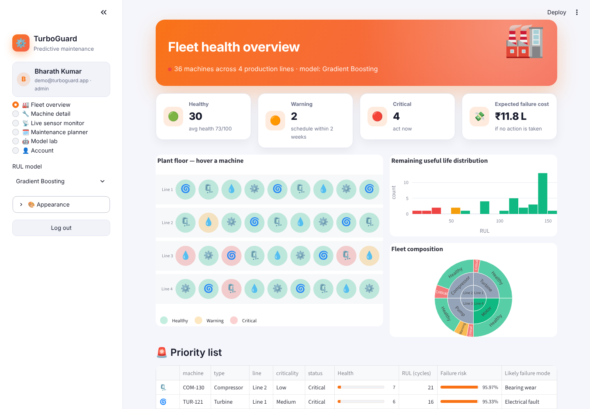
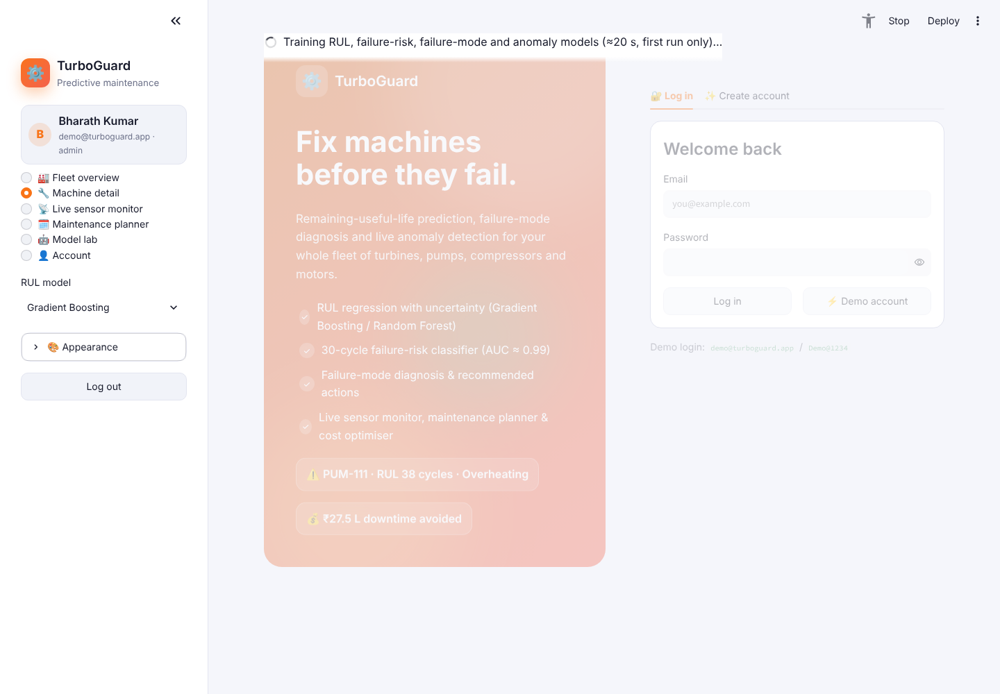
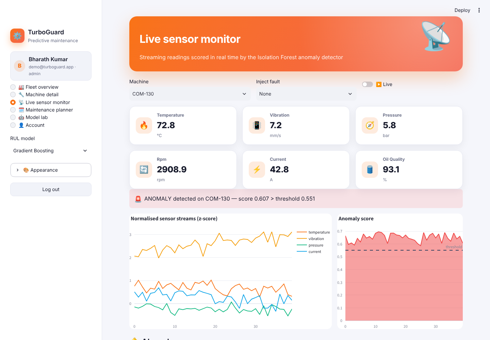
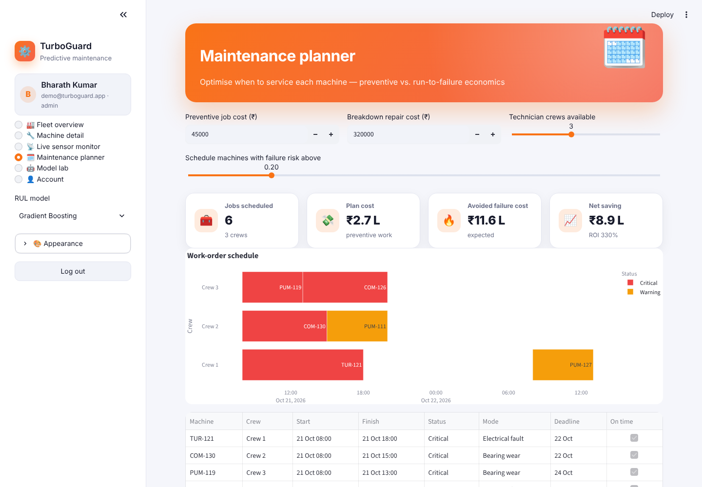
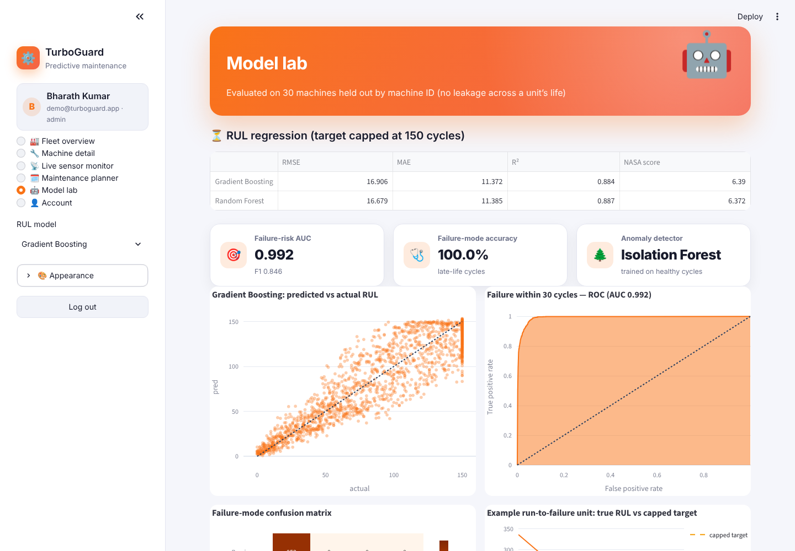
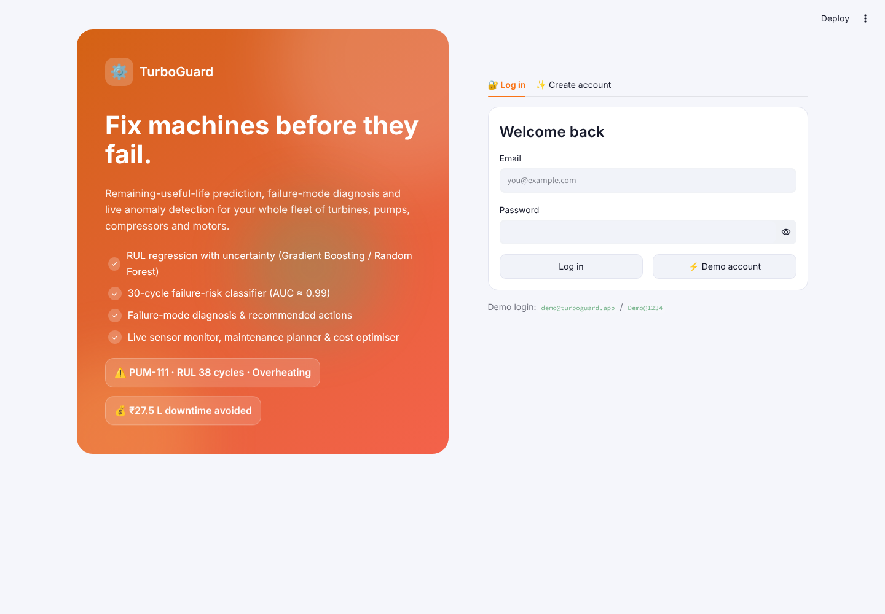

<div align="center">

# ⚙️ TurboGuard — AI Predictive Maintenance

**Predict remaining useful life, diagnose failure modes and catch anomalies live across a fleet of turbines, compressors, pumps and motors — then plan the cheapest maintenance schedule**


</div>

## ✨ Features

| Page | What it does |
|---|---|
| 🔐 **Register / login** | SQLite users with salted **PBKDF2-SHA256** hashing, password-strength meter, roles, demo account, change password |
| 🏭 **Fleet overview** | Interactive plant-floor map (status-coloured machines per production line), healthy / warning / critical KPIs, expected failure cost, RUL histogram, fleet sunburst, priority table with risk & health bars |
| 🔧 **Machine detail** | Health & failure-risk gauges, **RUL with 80 % interval**, likely failure mode, 6 sensor trend panels with rolling means and **Isolation-Forest anomaly markers**, feature importance, recommended actions and savings |
| 📡 **Live sensor monitor** | Real-time streaming readings, **fault injection** (vibration spike, overheat, pressure drop, current surge), anomaly score vs threshold, alarm log |
| 🗓️ **Maintenance planner** | Greedy crew scheduling into a **Gantt chart**, deadline checks against conservative RUL, plan cost vs avoided failure cost & ROI, **optimal risk-threshold curve**, work-order CSV export |
| 🤖 **Model lab** | RUL models (RMSE, MAE, R², NASA asymmetric score), predicted-vs-actual, failure-window ROC/AUC, failure-mode confusion matrix |
| 🎨 **Themes** | Light · Dark · Midnight · Sepia · Forest, 6 accents, animation toggle |

## 🧠 Models

| Task | Model | Target |
|---|---|---|
| Remaining useful life | Hist Gradient Boosting / Random Forest regressor | RUL, piece-wise capped at 150 cycles (C-MAPSS style) |
| Failure within 30 cycles | Random Forest classifier (balanced) | binary |
| Failure mode | Hist Gradient Boosting classifier | bearing wear · overheating · seal leak · electrical fault |
| Anomaly detection | Isolation Forest trained on healthy early-life cycles | anomaly score |

**Features** (31): per sensor raw value, 10-cycle rolling mean & std, 10-cycle slope and drift from the unit's own early-life baseline, plus load. Evaluation uses a **GroupShuffleSplit by machine** so no unit appears in both train and test.

**Data**: 120 simulated run-to-failure histories and a live fleet of 36 machines with temperature, vibration, pressure, rpm, current and oil-quality sensors; each failure mode leaves its own degradation signature.

## 🖼️ Screenshots

| Fleet overview | Machine detail |
|---|---|
|  |  |
| **Live sensor monitor** | **Maintenance planner** |
|  |  |
| **Model lab** | **Login** |
|  |  |

## 🚀 Run it

```bash
git clone https://github.com/PreciousBharath/TURBOGUARD-PREDICTIVE-MAINTENANCE.git
cd TURBOGUARD-PREDICTIVE-MAINTENANCE
pip install -r requirements.txt
streamlit run app.py
```

Click **⚡ Demo account** (`demo@turboguard.app` / `Demo@1234`). The first run trains all models (~20 s); they are cached afterwards.

## 📁 Project structure

```
app.py      # Streamlit UI — 6 pages
model.py    # simulation, feature engineering, RUL / risk / mode / anomaly models, fleet assessment
auth.py     # SQLite users + PBKDF2 hashing + login/register UI
theme.py    # 5 themes, accents, animated CSS, Plotly template
ui.py       # hero, KPI and result-card components
```

## 📄 License

MIT © Bharath
